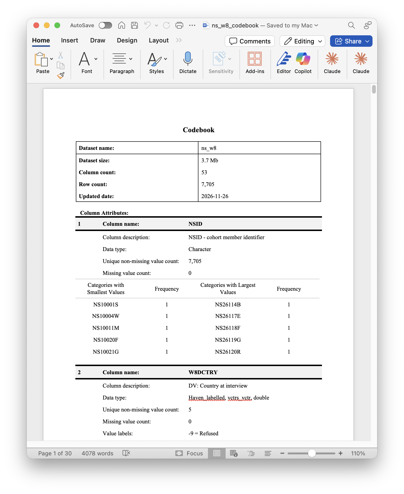

- [Download the R script for this page](../purl/next_steps-data_discovery.R)
- [Download the equivalent Stata script for this page](../do_files/next_steps-data_discovery.do)

# Introduction

In this section, we show a few `R` functions for exploring Next Steps data; there's a lot of data in Next Steps, so finding a specific variable can be challenging. Variable names do not always follow a consistent convention across the whole study: Sweeps 1-7 were managed by the Department for Education and Sweeps 8-9 by CLS, and the same concept is often named differently in the two eras. (The variable for the cohort member's GHQ-12 score is `W2ghq12scr` in Sweep 2 but `W8DGHQSC` in Sweep 8, for example.) In what follows, we will use the `R` functions to find variables for cohort members' GHQ-12 (12-item General Health Questionnaire), which has been collected in several of the sweeps.

The packages we will use are:

```{r}
#| warning: false
# Load Packages
library(tidyverse) # For data manipulation
library(haven) # For importing .dta files
library(labelled) # For searching imported datasets
library(codebookr) # For creating .docx codebooks
```

```{r}
#| include: false
# setwd(Sys.getenv("next_steps_fld"))
```

As a reminder, the Next Steps data files downloaded from the UK Data Service are stored across three subfolders: `safeguarded_eul`, `household_grids` and `activity_histories`. The code below assumes that your working directory is the folder that contains these three subfolders (see the [*Next Steps* landing page](https://cls-data.github.io/docs/next_steps.html)).

# `labelled::lookfor()`

The `labelled` package contains functionality for attaching and examining metadata in dataframes (for instance, adding labels to variables [columns]). Beyond this, it also contains the `lookfor()` function, which replicates similar functionality in `Stata`. `lookfor()` allows one to search for variables in a dataframe by keyword (regular expression); the function searches variable names as well as associated metadata (value and variable labels). It returns an object containing matching variables, their labels, and their types, etc.. Below, we read in the Next Steps Sweep 8 (age 25) dataset which contains derived variables (`safeguarded_eul/ns8_2015_derived.dta`) and use `lookfor()` to search for variables related to the `"GHQ"`.

```{r}
ns_w8 <- read_dta("safeguarded_eul/ns8_2015_derived.dta")

lookfor(ns_w8, "ghq")
```

Users may consider it easier to create a tibble of the `lookfor()` output, which can be searched and filtered using `dplyr` functions. Below, we create a `tibble` (a type of `data.frame` with good printing defaults) of the `lookfor()` output and use `filter()` to find variables with `"ghq"` in their labels. Note, we convert both the variable names and labels to lower case to make the search case insensitive.

```{r}
ns_w8_lookfor <- lookfor(ns_w8) %>%
  as_tibble() %>%
  mutate(variable_low = str_to_lower(variable),
         label_low = str_to_lower(label))

ns_w8_lookfor %>%
  filter(str_detect(label_low, "ghq"))
```

The output shows that GHQ information in the `safeguarded_eul/ns8_2015_derived.dta` dataset is stored in the variable `W8DGHQSC`.

# `codebookr::codebook()`

The Next Steps datasets that are downloadable from the UK Data Service come bundled with data dictionaries within the `mrdoc` subfolder. However, these are limited in some ways. The `codebookr` package enables the creation of data dictionaries that are more customisable, and in our opinion, easy to read. Below we create a codebook for the Next Steps Sweep 8 derived variable dataset. These codebooks are intended to be saved and viewed in Microsoft Word.

```{r}
cdb <- codebook(ns_w8)
print(cdb, "ns_w8_codebook.docx") # Saves as .docx (Word) file
```

A screenshot of the codebook is shown below.



# Create a Lookup Table Across All Datasets

Creating the `lookfor()` and `codebook()` one dataset at a time does not allow one to get a quick overview of the variables available in Next Steps, including the sweeps repeatedly measured characteristics are available in. Below we create a `tibble`, `df_lookfor`, that contains `lookfor()` results for all the `.dta` files in the three Next Steps subfolders.

To do this, we create a function, `create_lookfor()`, that takes a file path to a `.dta` file, reads in the first row of the dataset (faster than reading the full dataset), and applies `lookfor()` to it. We call this function with a `mutate()` function call to create a set of lookups for every `.dta` file we can find in the three subfolders (the argument `full.names = TRUE` means `list.files()` returns the subfolder as well as the file name; e.g., `safeguarded_eul/ns8_2015_derived.dta`). `map()` loops over every value in the `file_path` column, creating a corresponding lookup table for that file, stored as a [`list-column`](https://r4ds.hadley.nz/rectangling.html#list-columns). `unnest()` expands the results out, so rather than have one row per `file_path`, we have one row per variable. `separate()` splits the file path into two new columns, containing the subfolder and the file name.

Unlike the other CLS cohorts, the Next Steps files are not organised into a separate folder for each sweep. However, as [variable names begin with a prefix indicating the sweep](https://cls-data.github.io/docs/next_steps-data_structures.html) (`W1`, `W2`, ..., `W9`), we can instead extract the sweep from the variable name. We do this in the second `mutate()` step below using the `str_extract()` function, which takes a regular expression: `"^w(\\d)"` matches a `w` at the start of the variable name followed by a single digit (`\\d`), and `group = 1` returns the part of the match within the parentheses (i.e., the digit). Variables that do not have a sweep prefix (for example, `NSID`) are given the value `NA`.

```{r}
create_lookfor <- function(file_path){
  read_dta(file_path, n_max = 1) %>%
    lookfor() %>%
    as_tibble()
}

folders <- c("activity_histories", "household_grids", "safeguarded_eul")

df_lookfor <- tibble(file_path = list.files(folders, pattern = "\\.dta$", full.names = TRUE)) %>%
  mutate(lookfor = map(file_path, create_lookfor)) %>%
  unnest(lookfor) %>%
  mutate(variable_low = str_to_lower(variable),
         label_low = str_to_lower(label),
         sweep = str_extract(variable_low, "^w(\\d)", group = 1) %>%
           as.integer()) %>%
  separate(file_path,
           into = c("folder", "file"),
           sep = "/",
           remove = FALSE) %>%
  relocate(sweep, .after = file) %>%
  relocate(file_path, pos, .after = last_col())
```

We can use the resulting object to search for variables with `"ghq"` in their labels.

```{r}
df_lookfor %>%
  filter(str_detect(label_low, "ghq")) %>%
  select(file, sweep, variable, label)
```

The sweep prefix also makes it straightforward to see how the name of a variable changes over time. For instance, below we search for GHQ-12 *scores* (as opposed to the individual GHQ-12 items) by adding a second condition to `filter()`. The names follow one convention in the Sweep 2 and 4 files, and another in the Sweep 8 and 9 files.

```{r}
df_lookfor %>%
  filter(str_detect(label_low, "ghq"),
         str_detect(label_low, "score")) %>%
  select(file, sweep, variable, label)
```
